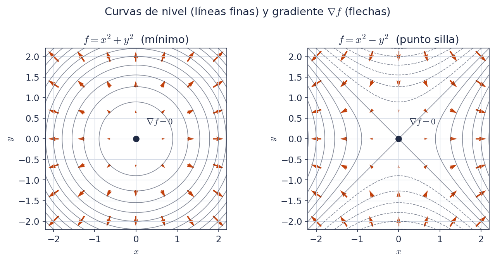
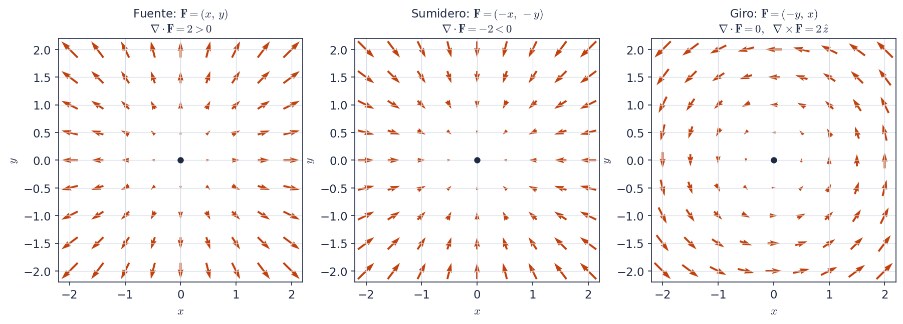

# Caja de herramientas matemática I: gradiente, divergencia y rotor

*Física 3 · Sesión 1 · Notas manuscritas transcriptas, ordenadas y revisadas*

Fuente original: `originals/Math_toolkit01.pdf` (4 páginas). Lo que escribiste vos aparece como texto normal. Todo lo que cambié o agregué está en un recuadro con una etiqueta y un código que coincide con el informe `reports/01-math-toolkit-changes.txt`:

> **[Corregido · C0]** Un error de las notas, arreglado. Indica qué decía y cómo queda.

> **[Aclarado · C0]** Una frase imprecisa o ambigua, reformulada sin cambiar la idea.

> **[Añadido por Claude · A0]** Contenido nuevo que no estaba en tus notas.

> **[Notación · N0]** Cambio de símbolos para que todo el cuaderno use el mismo criterio.

Si algún recuadro no te convence, borralo y el texto de tus notas originales sigue siendo coherente.

## 1. Notación

En las notas se usan $F$, $f$ y $T$ para el mismo tipo de objeto. Para evitar confusiones usamos:

| Símbolo | Significa | Ejemplo |
|---|---|---|
| $f,\ g$ | campo **escalar** (un número en cada punto) | $f(x,y,z)=x^2+y^3+z^4$ |
| $\mathbf{F},\ \mathbf{A}$ | campo **vectorial** (un vector en cada punto) | $\mathbf{F}=(F_x,\,F_y,\,F_z)$ |
| $\hat{x},\ \hat{y},\ \hat{z}$ | vectores unitarios de los ejes | |
| $p_0$ | un punto fijo del espacio | |

> **[Notación · N1]** En tus notas, el campo escalar aparece a veces como $F$ y a veces como $T$ (gradiente y Laplaciano), y el campo vectorial aparece como $T$ (divergencia y rotor). Acá el escalar es siempre $f$ y el vectorial siempre $\mathbf{F}$ (en negrita).

## 2. El operador nabla

El operador nabla es

$$\nabla \;=\; \hat{x}\,\frac{\partial}{\partial x} \;+\; \hat{y}\,\frac{\partial}{\partial y} \;+\; \hat{z}\,\frac{\partial}{\partial z}$$

Es un **operador diferencial vectorial**: no es un vector común ni una función, sino algo que "espera" un campo para actuar sobre él. Según sobre qué actúa y cómo, da tres operaciones distintas:

| Operación | Se aplica a | Resultado | Notación |
|---|---|---|---|
| Gradiente | campo escalar $f$ | campo vectorial | $\nabla f$ |
| Divergencia | campo vectorial $\mathbf{F}$ | campo escalar | $\nabla\cdot\mathbf{F}$ |
| Rotor (*curl*) | campo vectorial $\mathbf{F}$ | campo vectorial | $\nabla\times\mathbf{F}$ |

> **[Corregido · C3]** Tus notas escribían $\nabla = \left[\tfrac{\partial}{\partial x};\tfrac{\partial}{\partial y};\tfrac{\partial}{\partial z}\right]\cdot\left[\hat{x};\hat{y};\hat{z}\right]$. Es una suma de tres términos (derivada en cada eje por su vector unitario), no un producto escalar entre dos listas. Ver la fórmula de arriba.

> **[Aclarado · C11]** En tus notas el caso ① dice "producto por escalar: $\alpha\nabla T$". Lo que se hace es multiplicar $\nabla$ por un campo escalar (eso es el gradiente). Si además hay una constante $\alpha$, vale la linealidad: $\nabla(\alpha f)=\alpha\,\nabla f$.

## 3. Gradiente

### 3.1 Definición e interpretación

Para un campo escalar $f(x,y,z)$:

$$\nabla f \;=\; \frac{\partial f}{\partial x}\,\hat{x} \;+\; \frac{\partial f}{\partial y}\,\hat{y} \;+\; \frac{\partial f}{\partial z}\,\hat{z}$$

Cada componente (derivada parcial) es la razón de cambio de $f$ a lo largo de uno de los ejes. El gradiente apunta en la dirección de **máximo crecimiento** de $f$, y su módulo es la **tasa de crecimiento** (la pendiente) en esa dirección:

$$\lvert\nabla f\rvert \;=\; \sqrt{\left(\frac{\partial f}{\partial x}\right)^{2} + \left(\frac{\partial f}{\partial y}\right)^{2} + \left(\frac{\partial f}{\partial z}\right)^{2}}$$

> **[Corregido · C1]** Tus notas decían que el gradiente "indica hacia dónde se encuentra el máximo cambio de pendiente". Lo correcto es que indica hacia dónde **crece más rápido la función** (la pendiente es el módulo del gradiente, no lo que cambia).

> **[Corregido · C2]** "Radio de crecimiento" pasa a "tasa de crecimiento" (rate, no radius).

### 3.2 Puntos estacionarios

Si $\nabla f = \mathbf{0}$ en un punto $(x,y,z)$, ese punto es un **punto estacionario**: puede ser un máximo local, un mínimo local o un punto silla.

> **[Añadido por Claude · A2]** Tres datos que completan la idea:
>
> - $\nabla f=\mathbf{0}$ es condición **necesaria** para un extremo, pero no suficiente: por eso también existen los puntos silla.
> - La derivada de $f$ en la dirección de un vector unitario $\hat{u}$ es $D_{\hat{u}}f=\nabla f\cdot\hat{u}$. Es máxima cuando $\hat{u}$ apunta como $\nabla f$, y vale entonces $\lvert\nabla f\rvert$; eso justifica la interpretación de 3.1.
> - El gradiente es **perpendicular a las curvas (o superficies) de nivel** de $f$, como se ve en la figura.

> **[Añadido por Claude · A1]** La figura 1 no estaba en tus notas. Se genera con `figures/make_figures.py`.

### 3.3 Ejemplo: hallar el gradiente (Problema 1.11 en tus notas)

Dado $f(x,y,z)=x^2+y^3+z^4$:

$$\nabla f = \frac{\partial}{\partial x}\!\left(x^2+y^3+z^4\right)\hat{x} + \frac{\partial}{\partial y}\!\left(x^2+y^3+z^4\right)\hat{y} + \frac{\partial}{\partial z}\!\left(x^2+y^3+z^4\right)\hat{z}$$

$$\nabla f = (2x)\,\hat{x} + (3y^2)\,\hat{y} + (4z^3)\,\hat{z}$$

$$\boxed{\;\nabla f = \left(2x,\ 3y^2,\ 4z^3\right)\;}$$

> **[Añadido por Claude · A9]** Comprobación numérica: en $(1,2,1)$ queda $\nabla f=(2,\,12,\,4)$ y $\lvert\nabla f\rvert=\sqrt{2^2+12^2+4^2}=\sqrt{164}\approx 12{,}8$. Además, $\nabla f=\mathbf{0}$ solo en el origen.

## 4. Divergencia

Para un campo vectorial $\mathbf{F}=(F_x,F_y,F_z)$:

$$\nabla\cdot\mathbf{F} \;=\; \frac{\partial F_x}{\partial x} + \frac{\partial F_y}{\partial y} + \frac{\partial F_z}{\partial z}$$

El resultado es un **escalar**: se pierde el carácter vectorial. La divergencia indica cuánto se esparce o *diverge* el campo desde un punto $p_0$:

| Signo | Qué se ve | Nombre del punto |
|---|---|---|
| $\nabla\cdot\mathbf{F}(p_0)>0$ | las flechas "apuntan" hacia afuera | **fuente** |
| $\nabla\cdot\mathbf{F}(p_0)<0$ | las flechas "apuntan" hacia adentro | **sumidero** |
| $\nabla\cdot\mathbf{F}(p_0)=0$ | sale tanto como entra | ni fuente ni sumidero |

> **[Corregido · C4]** Tus notas escribían la divergencia como $\tfrac{\partial T}{\partial x}+\tfrac{\partial T}{\partial y}+\tfrac{\partial T}{\partial z}$, con el mismo símbolo $T$ en los tres términos. Para un campo vectorial se deriva cada componente respecto de su propio eje ($F_x$ respecto de $x$, etc.), como arriba.

> **[Aclarado · C5]** Las notas decían que la divergencia "da una noción de la velocidad con la que nos movemos respecto a $p_0$". Más precisamente: mide la **tasa de expansión** del campo, es decir, el flujo neto que sale de un entorno pequeño de $p_0$ por unidad de volumen.

> **[Corregido · C6]** Las notas decían "$\nabla\cdot\mathbf{T}\le 0$ son sumideros". El caso $=0$ no es un sumidero: ahí el flujo neto es nulo. Queda $<0$ para sumideros y $=0$ aparte.

## 5. Rotor (*curl*)

$$\nabla\times\mathbf{F} \;=\; \begin{vmatrix} \hat{x} & \hat{y} & \hat{z} \\[2pt] \dfrac{\partial}{\partial x} & \dfrac{\partial}{\partial y} & \dfrac{\partial}{\partial z} \\[6pt] F_x & F_y & F_z \end{vmatrix}$$

Desarrollando el determinante por la primera fila:

$$\nabla\times\mathbf{F} = \left(\frac{\partial F_z}{\partial y}-\frac{\partial F_y}{\partial z}\right)\hat{x} \;-\; \left(\frac{\partial F_z}{\partial x}-\frac{\partial F_x}{\partial z}\right)\hat{y} \;+\; \left(\frac{\partial F_y}{\partial x}-\frac{\partial F_x}{\partial y}\right)\hat{z}$$

El rotor indica **cuánto y cómo rota** un campo alrededor de $p_0$.

> **[Añadido por Claude · A7]** Cómo leer el resultado: la dirección de $\nabla\times\mathbf{F}$ es el **eje de giro**, y el sentido sale de la regla de la mano derecha (los dedos siguen la rotación, el pulgar da la dirección). Su módulo mide la intensidad del giro: para una rotación rígida con velocidad angular $\boldsymbol{\omega}$, el rotor vale $2\boldsymbol{\omega}$.

> **[Añadido por Claude · A3]** La figura 2 no estaba en tus notas. Comprobá con las fórmulas: para $\mathbf{F}=(-y,\,x,\,0)$, $\nabla\cdot\mathbf{F}=0+0+0=0$ y $\nabla\times\mathbf{F}=\left(\tfrac{\partial x}{\partial x}-\tfrac{\partial(-y)}{\partial y}\right)\hat{z}=2\,\hat{z}$.

## 6. Propiedades de los productos y reglas con $\nabla$

> **[Añadido por Claude · A4]** Tus notas pedían buscar las propiedades de los productos $\cdot$ y $\times$ y omitir esa línea. Acá están (ver Griffiths §1.1 y §1.2.6). La línea de pedido no se copió al cuaderno.

### 6.1 Producto escalar y vectorial entre vectores

| | Producto escalar $\mathbf{A}\cdot\mathbf{B}$ | Producto vectorial $\mathbf{A}\times\mathbf{B}$ |
|---|---|---|
| Resultado | escalar | vector |
| En componentes | $A_xB_x+A_yB_y+A_zB_z$ | determinante con $\hat{x},\hat{y},\hat{z}$ |
| Geometría | $\lvert\mathbf{A}\rvert\lvert\mathbf{B}\rvert\cos\theta$ | $\lvert\mathbf{A}\rvert\lvert\mathbf{B}\rvert\sin\theta$ = área del paralelogramo; perpendicular a ambos (mano derecha) |
| Orden | conmutativo: $\mathbf{A}\cdot\mathbf{B}=\mathbf{B}\cdot\mathbf{A}$ | **anticonmutativo**: $\mathbf{A}\times\mathbf{B}=-\mathbf{B}\times\mathbf{A}$ |
| Distributivo | $\mathbf{A}\cdot(\mathbf{B}+\mathbf{C})=\mathbf{A}\cdot\mathbf{B}+\mathbf{A}\cdot\mathbf{C}$ | $\mathbf{A}\times(\mathbf{B}+\mathbf{C})=\mathbf{A}\times\mathbf{B}+\mathbf{A}\times\mathbf{C}$ |
| Consigo mismo | $\mathbf{A}\cdot\mathbf{A}=\lvert\mathbf{A}\rvert^2$ | $\mathbf{A}\times\mathbf{A}=\mathbf{0}$ |
| Caso nulo | $=0$ si son perpendiculares | $=\mathbf{0}$ si son paralelos |
| Asociatividad | no aplica (no se puede encadenar) | **no** es asociativo |

Productos triples:

$$\mathbf{A}\cdot(\mathbf{B}\times\mathbf{C}) = \mathbf{B}\cdot(\mathbf{C}\times\mathbf{A}) = \mathbf{C}\cdot(\mathbf{A}\times\mathbf{B}) \quad\text{(volumen del paralelepípedo, simetría cíclica)}$$

$$\mathbf{A}\times(\mathbf{B}\times\mathbf{C}) = \mathbf{B}\,(\mathbf{A}\cdot\mathbf{C}) - \mathbf{C}\,(\mathbf{A}\cdot\mathbf{B}) \quad\text{(regla «BAC menos CAB»)}$$

### 6.2 Reglas de producto con $\nabla$

Linealidad: $\nabla(f+g)=\nabla f+\nabla g$, y lo mismo para $\nabla\cdot$ y $\nabla\times$.

Productos de campos:

$$\nabla(fg) = f\,\nabla g + g\,\nabla f$$

$$\nabla\cdot(f\mathbf{A}) = f\,(\nabla\cdot\mathbf{A}) + \mathbf{A}\cdot(\nabla f)$$

$$\nabla\times(f\mathbf{A}) = f\,(\nabla\times\mathbf{A}) - \mathbf{A}\times(\nabla f)$$

$$\nabla\cdot(\mathbf{A}\times\mathbf{B}) = \mathbf{B}\cdot(\nabla\times\mathbf{A}) - \mathbf{A}\cdot(\nabla\times\mathbf{B})$$

$$\nabla(\mathbf{A}\cdot\mathbf{B}) = \mathbf{A}\times(\nabla\times\mathbf{B}) + \mathbf{B}\times(\nabla\times\mathbf{A}) + (\mathbf{A}\cdot\nabla)\mathbf{B} + (\mathbf{B}\cdot\nabla)\mathbf{A}$$

$$\nabla\times(\mathbf{A}\times\mathbf{B}) = (\mathbf{B}\cdot\nabla)\mathbf{A} - (\mathbf{A}\cdot\nabla)\mathbf{B} + \mathbf{A}\,(\nabla\cdot\mathbf{B}) - \mathbf{B}\,(\nabla\cdot\mathbf{A})$$

> **[Añadido por Claude · A5]** Las seis identidades de arriba las verifiqué simbólicamente con campos genéricos (SymPy), no de memoria. Por ahora basta con saber que existen y dónde buscarlas; se memorizan las tres primeras.

## 7. Operadores de segundo orden

Aplicando $\nabla$ dos veces hay cinco combinaciones posibles:

| | Expresión | Resultado | Comentario |
|---|---|---|---|
| (a) | $\nabla\cdot(\nabla f)=\nabla^2 f$ | escalar | **Laplaciano** |
| (b) | $\nabla\times(\nabla f)=\mathbf{0}$ | vector | **siempre** nulo |
| (c) | $\nabla(\nabla\cdot\mathbf{F})$ | vector | rara vez aparece en física, sin nombre especial |
| (d) | $\nabla\cdot(\nabla\times\mathbf{F})=0$ | escalar | **siempre** nulo |
| (e) | $\nabla\times(\nabla\times\mathbf{F})=\nabla(\nabla\cdot\mathbf{F})-\nabla^2\mathbf{F}$ | vector | identidad conocida |

### (a) Laplaciano: divergencia del gradiente

$$\nabla\cdot(\nabla f) = \left(\hat{x}\,\frac{\partial}{\partial x}+\hat{y}\,\frac{\partial}{\partial y}+\hat{z}\,\frac{\partial}{\partial z}\right)\cdot\left(\frac{\partial f}{\partial x}\,\hat{x}+\frac{\partial f}{\partial y}\,\hat{y}+\frac{\partial f}{\partial z}\,\hat{z}\right)$$

$$\Rightarrow\quad \nabla^2 f = \frac{\partial^2 f}{\partial x^2} + \frac{\partial^2 f}{\partial y^2} + \frac{\partial^2 f}{\partial z^2}$$

> **[Corregido · C7]** El título de tus notas era "divergencia de la divergencia". Es la divergencia **del gradiente**: primero se calcula $\nabla f$ (un vector) y después su divergencia.

> **[Corregido · C8]** La línea final de tus notas decía $\nabla\cdot(\nabla\times F)=\dfrac{\partial^2 T}{\partial x^2}+\dots$, con un $\times$ de más y con $F$ y $T$ mezclados. Es $\nabla\cdot(\nabla f)$, y el resultado ($\nabla^2 f$) usa el mismo escalar $f$ en todos los términos.

### (b) y (d): los dos ceros

$$\nabla\times(\nabla f)=\mathbf{0}\qquad\qquad \nabla\cdot(\nabla\times\mathbf{F})=0$$

Valen **siempre** (para campos con derivadas segundas continuas, porque las derivadas cruzadas conmutan). Los dos ceros se usan constantemente en electromagnetismo.

> **[Añadido por Claude · A6]** Conexión con el curso (se verá en Griffiths cap. 2 y 5): como $\nabla\times(\nabla f)=\mathbf{0}$, si un campo tiene rotor nulo se lo puede escribir como un gradiente (el campo eléctrico estático: $\mathbf{E}=-\nabla V$). Como $\nabla\cdot(\nabla\times\mathbf{A})=0$, un campo escrito como rotor tiene divergencia nula (el campo magnético: $\mathbf{B}=\nabla\times\mathbf{A}$).

### (e) Rotor del rotor

$$\nabla\times(\nabla\times\mathbf{F}) = \nabla(\nabla\cdot\mathbf{F}) - \nabla^2\mathbf{F}$$

donde $\nabla^2\mathbf{F}=(\nabla^2F_x)\,\hat{x}+(\nabla^2F_y)\,\hat{y}+(\nabla^2F_z)\,\hat{z}$ es el **Laplaciano vectorial** (el Laplaciano aplicado a cada componente).

> **[Corregido · C9]** Tus notas escribían $\nabla\times(\nabla\times\mathbf{T})=\nabla(\nabla\cdot\mathbf{T})=-\nabla^2\mathbf{T}$. Eso mezcla dos cosas: la identidad correcta tiene una **resta**, $\nabla(\nabla\cdot\mathbf{F})-\nabla^2\mathbf{F}$, y no hay un segundo signo igual. Esta identidad la verifiqué simbólicamente.

> **[Corregido · C10]** Tus notas decían "no da un resultado conocido". Sí lo da: es la identidad de arriba, que más adelante se usa, por ejemplo, para obtener la ecuación de ondas a partir de las ecuaciones de Maxwell. Por eso el caso (c) aparece dentro de este.

## 8. Pendientes para próximas sesiones

Quedan fuera de esta nota, y están en tu lista de la sesión 1: el teorema de la divergencia y de Stokes (B), coordenadas esféricas y cilíndricas (C) y la delta de Dirac (D). Cuando las tengas escritas, las sumamos como `02-...md`.

## 9. Hoja resumen (1 página)

**Definiciones**

| | Fórmula | Resultado |
|---|---|---|
| $\nabla$ | $\hat{x}\,\partial_x+\hat{y}\,\partial_y+\hat{z}\,\partial_z$ | operador |
| Gradiente | $\nabla f=(\partial_x f,\ \partial_y f,\ \partial_z f)$ | vector |
| Divergencia | $\nabla\cdot\mathbf{F}=\partial_xF_x+\partial_yF_y+\partial_zF_z$ | escalar |
| Rotor | $\nabla\times\mathbf{F}=(\partial_yF_z-\partial_zF_y,\ \partial_zF_x-\partial_xF_z,\ \partial_xF_y-\partial_yF_x)$ | vector |
| Laplaciano | $\nabla^2 f=\partial_x^2f+\partial_y^2f+\partial_z^2f$ | escalar |

**Interpretación**

- $\nabla f$ apunta hacia el máximo crecimiento; $\lvert\nabla f\rvert$ es la tasa; es perpendicular a las curvas de nivel; $\nabla f=\mathbf{0}$ en extremos y sillas.
- $\nabla\cdot\mathbf{F}>0$ fuente, $<0$ sumidero, $=0$ flujo neto nulo.
- $\nabla\times\mathbf{F}$: eje y sentido del giro (mano derecha); módulo = intensidad.

**Identidades de segundo orden**

$$\nabla\times(\nabla f)=\mathbf{0}\qquad \nabla\cdot(\nabla\times\mathbf{F})=0\qquad \nabla\times(\nabla\times\mathbf{F})=\nabla(\nabla\cdot\mathbf{F})-\nabla^2\mathbf{F}$$

**Productos de vectores**

- $\mathbf{A}\cdot\mathbf{B}=\lvert\mathbf{A}\rvert\lvert\mathbf{B}\rvert\cos\theta$, conmutativo; $\mathbf{A}\times\mathbf{B}=-\mathbf{B}\times\mathbf{A}$, módulo $\lvert\mathbf{A}\rvert\lvert\mathbf{B}\rvert\sin\theta$.
- $\mathbf{A}\cdot(\mathbf{B}\times\mathbf{C})$ es cíclico; $\mathbf{A}\times(\mathbf{B}\times\mathbf{C})=\mathbf{B}(\mathbf{A}\cdot\mathbf{C})-\mathbf{C}(\mathbf{A}\cdot\mathbf{B})$.

**Reglas de producto con $\nabla$ (las tres básicas)**

$$\nabla(fg)=f\nabla g+g\nabla f\qquad \nabla\cdot(f\mathbf{A})=f\,\nabla\cdot\mathbf{A}+\mathbf{A}\cdot\nabla f\qquad \nabla\times(f\mathbf{A})=f\,\nabla\times\mathbf{A}-\mathbf{A}\times\nabla f$$

**Ejemplo guardado:** $f=x^2+y^3+z^4\ \Rightarrow\ \nabla f=(2x,\ 3y^2,\ 4z^3)$.

> **[Añadido por Claude · A8]** Esta hoja resumen es el "output: 1 page cheat sheet" de tus notas. En el HTML se imprime en una página aparte (Ctrl+P).
